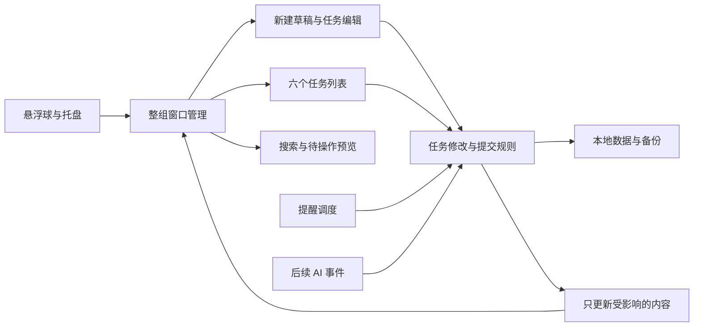

# 任务面板从零重写的实现思路

## 2026-10-14 卡片与输入修订思路

0.7只压缩卡片内部纵向留白，不通过缩小字体或全局Label样式影响编辑表单。TextBox模板Padding只能扣一次；特别是固定高度搜索框，必须检查实际文字视口和绘制像素，Text有值不代表可见。圆角Clip同时限定绘制和命中；留白内点击手动聚焦，边框外不触发。

选择菜单放在按钮下方，触发框保持可点击。关闭手势在IsOpen变为false时记录，不能依赖可能在淡出后才到达的Closed；用真实鼠标复验第二次和第三次点击。透明子绘制表面提供自己的自动化根，便于准确检测真实控件，独立键盘消息队列不改。

拖动开始缓存一次图像，跟随窗口只改物理位置并穿透鼠标，避免阻挡目标列。落点变化才调整虚线卡片占位，按照目标宽度和列规则预览；相同位置不重建。预览修改视图，不改正式模型；落下后一次提交，取消统一恢复，球仍在所有绘制层之上。最终性能和桌面证据以IMPLEMENTATION及VERIFICATION-0.7.0为准。

日期：2026-10-12。依据：[新版PRD](PRD.md)、[任务清单](TASKS.md)与删除前的旧源码。此文保存写法和逻辑，不是已开发的新程序，也不替代PRD中的待确认选择。

旧程序最有价值的是桌面窗口管理和数据保护。新版应按需求重新组织：借鉴局部做法，重新建立草稿、详情阶段和AI会话的关系。详细匹配见 [功能对应表](legacy/FEATURE-MAP.md)，源码证据见 [30组局部摘录](legacy/evidence/SOURCE-EXCERPTS.md)。下文的E编号都指这些已保存的摘录；旧文件名和行号是历史来源，清理后不再是当前源码链接。

## 1 建议的整体分工

让一个常驻后台负责数据、提醒和连接，让窗口只负责显示和接收操作。关掉界面只是隐藏这些窗口；退出程序才结束后台。把“改任务、改列表、提醒到期、AI状态变化”统一交给任务规则处理，避免不同入口各写一套结果。

这是职责建议，不锁定技术栈。现有C#、WPF和Windows系统调用证明了原型的可行路径；从零重写仍需单独确定实现方式。以下参数描述旧代码，不自动变成新版参数。

## 2 L01 常驻悬浮球与托盘

对应M01、T01至T03。历史证据E01、E02、E03、E30。

**旧写法：**`App.OnStartup`创建数据仓库、看板协调窗口、悬浮球和托盘。程序采用显式退出；托盘单击与球单击都调用同一展开入口。`ExitApp`先保存，再停止提醒、释放托盘和关闭窗口。以数据目录计算互斥标识，避免同一份数据同时被两个程序修改。

**新版思路：**保持一个“面板已展开”状态，悬浮球和托盘都调用同一个切换动作。列表、编辑、搜索扩展、预览都登记到窗口管理器，避免各自控制可见性。退出与收起分开；收起不销毁编辑内容。

悬浮球右键输入分成“等待、菜单、拖动”三个过程：按下先记时间和起点，满足长按/移动条件进入拖动；释放时只有未拖动的短按才弹菜单。旧球使用左键拖动，必须重写，不能照搬E03。阈值仍待交互调节。

悬浮球与托盘的右键菜单由同一份动作定义生成，托盘额外增加退出，避免两套菜单维护不一致。首次快捷方式和开机启动旧版没有实现；便携目录、每台电脑首次标记和路径修复按D09定稿，不能把普通本地运行当成已有自启能力。

## 3 L02 独立窗口布局与透明外观

对应M02、T04、T06、T07。证据E04至E08、E22至E24。

**旧写法：**每个分组编号对应一个独立窗口；默认布局取显示器可用区域，扣除边距与缝隙后平均分列，宽度不足时增加行数。位置通过原生窗口边界读取，以屏幕像素保存，显示时再放回窗口。超出屏幕的位置夹回可见区域。

**新版思路：**窗口编号只表示对应列表，位置和大小是另一份设置。首次用默认布局，之后优先用用户保存的位置。单列移动只修改这一列；旧`MoveInOrder`会挤压左右邻列，与新版“自由移动”冲突，应舍弃。对齐虚线和吸附旧版有实现，但新版未明确要求，不自动带入范围。

顶部移动时记住鼠标屏幕坐标与窗口起点，后续位置等于起点加鼠标位移。取消恢复本次移动前位置；完成才持久保存。拖动区只覆盖非按钮区域，不改变指针。旧代码每次重建内容向同一窗口追加Esc监听，新版必须只注册一次或在拆除时解除。

尺寸入口分两种：四边模式临时启用四边命中区；右下角模式由设置统一显示角标。旧系统钩子把所有边缘都判为普通客户区，会阻止系统四边缩放，不能原样复制。两种模式都应用最小尺寸，结束时保存，恢复默认位置时清除旧布局。

**毛玻璃逻辑：**背景透明只是第一步，还需请求Windows原生背景合成；圆角内容与原生裁剪区域必须一致。旧版`Native.Glass`先尝试Acrylic，再尝试系统背景，失败时用暗色实底。新版保留降级分支，持续缩放时同步更新裁剪区域。系统接口的兼容性需在目标Windows版本验证。

屏幕像素和界面逻辑尺寸不可混用。尤其是多屏不同缩放、负坐标显示器、拔掉屏幕后找回窗口，都要重新验收；旧版并没有完成这些实机验证。

## 4 L03 统一展开收起与动效

对应T02、T05及A01、A02。证据E02、E09、E10。

**旧写法：**窗口动画共享一个时钟，记录每个窗口的目标、起点和延迟；已经向某方向运动时不重复启动，方向反转从当前画面继续。没有动画时停掉计时器。旧版实际是0.86到1的缩放回弹，单列110毫秒，另加各列延迟，整体约190毫秒。

**新版思路：**借用“共享时钟、可反转、结束停计时”的机制，重新写成顶部向下揭开的超快速动效，而非缩放回弹。可让内容保持最终尺寸，通过裁剪或位移显示进度，避免动画中反复重新排版所有卡片。实现要同时处理毛玻璃背景，不能只动文字而把整块背景留在原处。

窗口管理器收到目标后统一通知所有列表。收起期间停止窗口交互，展开结束恢复；迅速点击时取消旧目标并转向新目标，不能累积多个结束回调。各列是否错开、收起方向按D07定稿。

编辑窗口的隐藏只是改变可见状态，并保留未提交内容。再次展开时恢复上一次编辑窗口，不自动弹出新的空编辑窗口。不能沿用旧版外部鼠标点击自动收起逻辑去关闭任务编辑。

## 5 L04 任务数据与状态规则

对应M03、T08、T09。证据E11、E12、E19。

**旧写法：**任务包含分组编号，排序由全局任务数组位置表示；分组改名不会改变编号。`Logic.Move`负责跨列、固定分组和排序，在原位置移除后插入新位置。往后移动时需要扣除移除自身占掉的一位。

**新版思路：**单独保存建立状态、所在列表、详情阶段当前指针、AI会话关联和执行记录。编辑字段与卡片拖放调用同一个“移动到列表”的规则，保证状态字段等于所在列表。完成任务是否停止提醒、AI事件是否允许跨列，按D11、D12确定。

排序建议按列表保存有序任务编号，或每任务保存所在列和顺序值；两种形式都必须保证同列顺序稳定。全局数组也是可行参考，但后续飞书同步时不宜只靠数组下标辨认任务。任务、阶段、字段选项和会话关联都有稳定编号。

灵感库只是一种显示和录入规则，不是删掉其他阶段的动作。跨列保留全部内容；不要把旧“固定在灵感库”直接解释成自动删除/重建阶段。

## 6 L05 新建编辑与多个暂存窗口

对应M04、T10至T12、T25。证据E13、E14。

**旧写法：**打开编辑器时复制任务到内存草稿，保存才替换正式任务；取消自然丢掉内存草稿。提醒在后台变化时，只把用户修改的提醒字段合回最新提醒。编辑窗口通过`ShowDialog`打开，因此阻塞主窗口，没有持久新建草稿和同时可操作的堆叠编辑器。

**新版思路：**把编辑中的内容放进独立编辑会话，界面读取它，不直接修改正式任务。新建草稿与已有任务编辑分开处理：

| 动作 | 新建任务 | 已建任务编辑 |
| --- | --- | --- |
| 输入 | 非空内容自动暂存到本地，不进入六列 | 只改编辑会话，不立即改正式任务 |
| 点击保存 | 校验并生成一项正式任务，清掉对应新建草稿 | 将用户修改的字段提交正式任务 |
| 点击X | 暂存并隐藏该草稿窗口 | 放弃本次未提交修改并关闭窗口 |
| 点击悬浮球 | 暂存并收起，展开后可以继续 | 保留窗口和输入，展开恢复继续编辑 |
| 点击窗外 | 按正常窗口交互保留；不依失焦删除草稿 | 明确保留窗口，不提交也不关闭 |
| 完全退出 | 非空新建草稿持久保留 | 未提交编辑是否跨进程恢复仍待讨论，不自动当作保存 |

堆叠窗口应为互不阻塞的窗口，每份草稿对应一个编号。堆叠管理器保存顺序、当前活动窗口和露出的切换区域，重排只调整窗口位置/层级，不复制任务内容。最右虚线入口创建新草稿。重复打开同一已建任务是否聚焦已有窗口按D02剩余部分定稿。

自动暂存可采用短时间合并多次输入的方式，减少写盘；X、收起和退出前要立即完成尚未写入的非空新建草稿。空判断检查名称和每个阶段正文的有效文本，不只看是否有阶段卡片。新增空阶段或单选AI不会制造空任务。

编辑提交不能整体用旧副本覆盖最新任务。记录哪些字段真的被用户修改，提交时以当前正式任务为基础合并：用户改标题就改标题，不覆盖期间新增的AI执行结果或提醒待处理标记。日期/阶段等冲突需要明确提示或按已批准规则处理。

## 7 L06 详情阶段与卡片摘要

对应M05、T13、T14。证据E11、E13、E14；旧`BoardWindow.Card`、`StageLine`的定位见方法索引。

**关键差异：旧阶段是平台会话，新阶段是任务详情。**旧`Stage`含Platform、SessionId、Link、Pending、LastEventAt，没有每阶段任务正文。旧卡片显示主AI会话及最近两个副会话，不是“前一阶段、当前、后两阶段”的摘要。不能简单改名字继续用旧Stage。

**新版思路：**详情阶段保存稳定编号、默认序号、自定义名称和正文；任务另存当前阶段编号。初建阶段0；新阶段按序号生成名称，名称改成“需求整理”也不改变内部序号和编号。当前阶段由用户手动指定，增加阶段或AI交付不自动切换。已建任务中的这些改动点击保存才生效。

只剩一个阶段时，卡片显示正文，不展示名称与分隔。多个阶段时，先找当前阶段位置i，再取存在的i-1、i、i+1、i+2并按原顺序展示，最多四项。第一或最后阶段不足四项时不补其他阶段。当前正常字号，邻近阶段小两个字号单位，内容过长显示省略号。

原有独立输入卡片、圆角、换行和高度限制可作为样式经验。重新写阶段连续布局和横线；详情重复胶囊是否需要按D03确定。更新正文只更新该卡片，不重建六列。

## 8 L07 灵感库与卡片拖放

对应M06、M07、T15至T17。证据E12、E15、E26。

灵感库没有旧版对应的列内编辑实现。建议使用独立的行内编辑状态，复用名称/阶段0字段的校验与暂存规则；到何时正式保存按D04确定。灵感显示阶段0，不改变其他阶段正文；拖出后仍可查看。不要让行内草稿成为正式搜索结果。

拖放借鉴旧版“带任务编号的数据包”：拖动起点只记录编号，接收列查正式任务，卡片上半部表示插到前面，下半部表示插到后面。最终提交到统一任务规则并记录可撤销操作。

点击和拖动用同一套判定：鼠标按下只记录，超过位移阈值进入拖动；松开且没拖动才编辑。按钮、输入框的操作优先，文字选择不能变成卡片拖动。取消拖动不改正式数据。旧版7像素阈值仅是参考，不锁定新版。

旧版`AutoScroll`只严格检查横坐标，竖向超出也可能触发别列滚动；新版只滚动当前有效落点列。`DragOver`先验证自己的任务数据类型，不把任意外部拖入都表示为可移动。

旧撤销只保留一个删除对象和20秒截止时间。若D06选择支持删除/移动/排序，应记录动作前的列表与顺序、任务内容或稳定编号，形成有上限的操作栈；后台AI事件不当作普通鼠标动作撤销。

## 9 L08 字段选项和颜色

对应M08、T18，参考E25、E26。

旧版仅有通用胶囊、颜色刷复用、固定平台选项，没有可配置AI多选、优先级字典、选项右侧颜色按钮。

**新版思路：**AI和优先级分别保存选项表，选项有编号、名称、颜色；任务只引用选项编号。一个选项改色只更新选项表，所有相应胶囊立即能显示同一种颜色。旧主题维护共享色刷的方式可作为参考，但新字段颜色应由选项配置驱动。

下拉框的选择区域和右侧颜色按钮分别处理点击，点击颜色按钮不顺便选中/取消该AI。新增选项只增加分类，不自动增加平台连接器。已选AI胶囊仍可显示“未接入”，连接状态来自设置验证结果。

选项删除/重命名、优先级是否可改色按D08处理。透明背景要验证文字对比度；颜色不能只靠底色表达含义。

## 10 L09 搜索与悬浮预览

对应M09、T19、T21。证据E16、E17。

**旧写法：**输入变化后等待130毫秒合并频繁输入，再对任务名称、备注、标签、AI会话阶段名称做不区分大小写的匹配，重建过滤后的六列。结果不包含阶段正文，也没有独立上浮结果、跳转或闪烁。

**新版思路：**搜索一份由任务名称和所有详情阶段正文组成的文本；新建草稿不进入正式结果。保留轻量输入合并机制，但结果列表与六列分别显示，不为了搜索就全量重建看板。

每条结果携带任务编号和列表编号。点击先展开目标列并滚动到卡片，布局就绪后闪红两次，再恢复原颜色。用户连续点多个结果时，取消前一次高亮，防止颜色不能复原。滚动定位按编号查找，不保存可能过期的卡片对象。

悬浮球向左扩展为搜索、设置、球三个区域；实际边界以屏幕可用区限制，结果优先向上。搜索文本是输入状态，关闭结果列表不清空；X明确清空。

待操作悬浮预览旧版没有。它从正式任务中读取“待操作”一列，只取名称、当前阶段正文、AI和优先级；不要另建一份重复任务数据。悬停延迟、移入预览保留、与菜单/搜索互斥及点击动作按D10处理。

## 11 L10 提醒和后台待处理

对应M10、T20、T25。证据E18、E02、E14。

**旧写法：**每10秒检查一次正式任务的到期时间，设置待处理，记录历史，将周期下一次时间推进到未来；一次查到多个到期任务时汇总系统通知。睡眠跨过多个周期只补发一次。提醒与是否显示面板分离，退出才停止。

**新版思路：**启用开关、提醒计划、下一次时间、待处理原因分开。未保存的新建草稿只保存配置，不进入调度。后台修改提醒结果时通知受影响卡片和预览，隐藏面板不需要先重建全部控件。

到期判断和推进下一次时间作为可以独立验证的规则，通知只是其输出。每天和每周按本地日历计算，避免只增加固定小时数导致跨夏令时地区偏移。提示重复去重，恢复后只补一次；完全退出没有后台服务，所以停机期间不会即时弹通知。

旧“稍后提醒”与正常到期时间同时触发存在冲突；如果新版继续提供稍后提醒，应明确它是推迟当前通知还是另一份独立计划，并统一处理。多项通知点击应能选择到期任务，不能像旧版只用一个`notifiedTask`定位第一项。

是否到期移列、完成后是否取消提醒、提示方式按D11定稿。时间到期与AI等待检查是两个原因，不能因为处理一项就清掉另一项。

## 12 L11 设置和AI连接

对应M11、T22、T23、C01至C04、F01至F03、O01。证据E19、E27及 [AI事件调用索引](legacy/evidence/ai-event-callers.json)。

旧版设置有外观、悬浮球、通知、备份恢复；平台说明明确未接入自动状态源。`StageEditor.OpenStage`校验链接协议，调用系统打开链接或用户选择的应用，记录已打开；它不证明准确会话已定位，也不清除待处理。

旧`Logic.ApplyEvent`负责去重、忽略旧事件、改变状态、按路由移动任务；调用关系证明其直接调用者只有自测，不能把它当成现成的Codex监听。旧自动切换主AI阶段也不能套到新版手动详情当前阶段。

**新版思路：**先区分四件事：任务上的AI标签、平台连接配置、任务到准确会话的关联、会话本次执行记录。用户在终端启动，随后手动关联；设置卡片验证连接成功才绿色，任务标签不会代替验证。

接入层只产生标准事件；任务规则决定结果如何显示、是否移到待操作。事件去重建议使用平台、会话、执行批次、事件编号，并保存最后已处理位置；如果真实平台保证全局唯一编号，可按验证后的格式简化。监听断开是状态待确认，不等于结束。详情当前阶段始终由用户手动选择。

Codex实际信号来源、能否执行后关联、恢复机制和流转按C01及D12讨论。飞书没有可直接复用的旧实现，需另写字段映射、同步冲突和删除规则。禁止仅因程序名称包含codex就认定某项任务正在执行。

## 13 L12 保存与故障保护

对应M12、T24、T28，证据E20、E21、E30。

**旧写法：**本地JSON保存全部数据；先写临时文件、刷盘，再原子替换主文件并生成备份。读取异常先保留损坏原件，再尝试备份，没有可用数据时停止，不用空看板覆盖。

**新版思路：**保留这条保护链，增加新版结构版本和草稿存储。正式任务与草稿有各自提交边界；后台按顺序写入，避免两个窗口同写同一个临时文件。连续输入合并写盘，明确保存/关闭时保证落盘。

导入校验覆盖选项表、空集合元素、阶段指针、选项引用、提醒频率、位置有限数值、重复编号与版本。旧校验没有检查AppPaths为空和Steps里的空对象，此前已复现读取接受、使用报空引用；不能照搬成完整验证。

发生错误显示真实结果：没落盘就是“保存失败”，不先关闭窗口或显示已保存。可保留待重试的内容，但不能把全局捕获所有异常当作修复数据。日志写入失败也应有备用提示。

便携数据跟文件夹走，机器相关启动入口另处理。当前旧用户数据另行保留，默认不导入新版；T09只在用户决定迁移时操作数据。

## 14 L13 流畅度与验证

对应T26、T27，证据E16、E28、E29、历史自测结果。

旧版通过整份数据JSON判断是否变化；无变化时复用窗口，但有一个任务变化就重建所有列。卡片全部放在普通堆叠面板，任务越多越多控件。旧验证记录200任务首次布局约2秒，不能当作新版性能已合格。

**新版思路：**给任务与选项建立明确修改通知，只刷新受影响任务、计数、搜索和预览。任务多时仅创建当前可见卡片，或采用分批创建；隐藏期间记下变更，展开时一次合并处理。动画期间不序列化全量数据，不每帧保存。

窗口与事件监听有明确创建和释放时机；不要在卡片刷新时重复注册窗口键盘事件。优先用鼠标事件和窗口管理状态，减少旧16毫秒全局鼠标轮询和250毫秒反复置顶。

沿用隔离测试数据的原则：验证草稿提交/放弃/隐藏恢复、后台字段合并、跨列排序、损坏恢复、提醒去重和准确会话归属。动效、跨缝隙拖动、混合缩放、毛玻璃和预览还需真实桌面验证。性能按PRD A17测试，旧自测通过只说明旧规则。

## 15 不能照搬的旧做法

| 旧做法 | 原因 | 新处理方向 |
| --- | --- | --- |
| 详情Stage就是AI会话 | 新版详情阶段有正文，含义不同 | 详情阶段与会话关联分开 |
| 模态编辑窗口和内存草稿 | 不支持多个堆叠窗口、持久新建草稿、收起恢复 | 独立编辑会话、非阻塞窗口、分清保存和X |
| 邻列比例压缩和强制顺序 | 与自由移动要求冲突 | 各列独立位置尺寸 |
| 缩放回弹0.19秒 | 与0.1秒下拉不同 | 保留动画调度思想，重写展示方式 |
| 左键移动球和外部点击自动收起 | 与新输入和编辑窗口规则冲突 | 右键短按/长拖区分；明确收起入口 |
| 全量重建和重复监听 | 容易卡顿和保留旧对象 | 增量更新、监听只注册一次 |
| platform:eventId去重 | 不同会话可能相同编号 | 验证实际事件标识，至少有会话维度 |
| 用整体旧草稿替换任务 | 可能丢失编辑期间后台更新 | 只合并用户修改字段 |
| 源码和运行包都写0.1版本 | 无法证明文件完全一致 | 留下哈希、成员比较和来源边界 |

PRD仍有待确认选择。这里给出的写法不能提前决定D03、D04、D06至D12及D02剩余问题。重写时先读对应需求，再读本节，最后按验收检查使用效果。

## 16 0.6实时背景及稳定绘制修订

当前实现不再使用全矩形系统Accent底板或缓存桌面截图。每个SurfaceWindow只保留一个顶层窗口，在同一窗口内由Windows合成局部实时背景，再叠合透明的WPF控件绘制表面。内部控件表面是子绘制句柄，不是第二个可移动的背景窗口。球、草稿帧和露出条的背景可独立裁形，透明虚线入口不创建背景视觉。

整窗的原生区域同时裁剪背景和控件；上层内容不再独立做一套矩形动画。移动不截图、不隐藏重显，位置更新后系统自行采样新的桌面背景。动画时钟从第一个可执行帧启动，避免首次布局耗尽动画时长。每帧只调整裁剪，区域和尺寸没有变化时复用合成对象。

透明子绘制表面拥有自己的输入消息队列，外层窗口不得先吞掉字符；普通输入、中文字符、快捷键与输入法由WPF本身处理。灵感自动建立卡片会改变列表容器位置，这次内部调整不得误判为用户离开编辑。

系统接口返回成功不证明视觉成功：需实际改变窗口背后的画面、采集移动与松开后的像素、核查原生隐藏事件，以及比较圆外区域和底层像素。跨屏混合DPI、其他Windows版本仍需要对应设备验证。

参考：[Microsoft桌面组合层](https://learn.microsoft.com/en-us/windows/uwp/composition/using-the-visual-layer-with-wpf)、[HostBackdropBrush采样窗口背后画面](https://learn.microsoft.com/en-us/uwp/api/windows.ui.composition.compositor.createhostbackdropbrush)、[透明子窗口的应用清单要求](https://learn.microsoft.com/en-us/windows/win32/winmsg/using-windows)。
